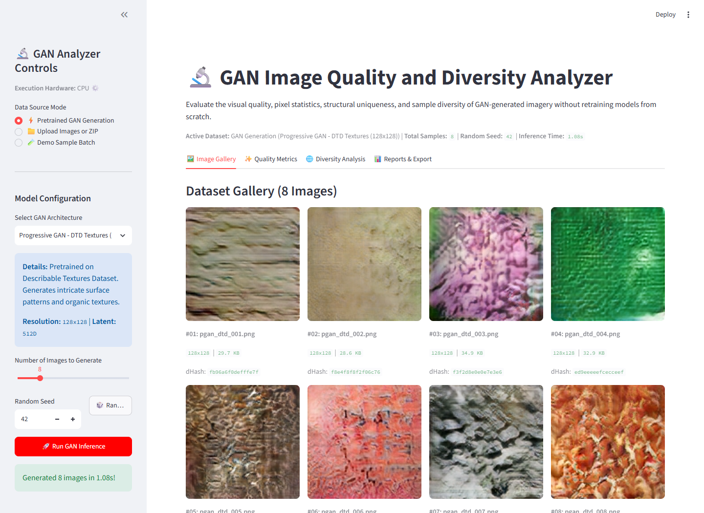
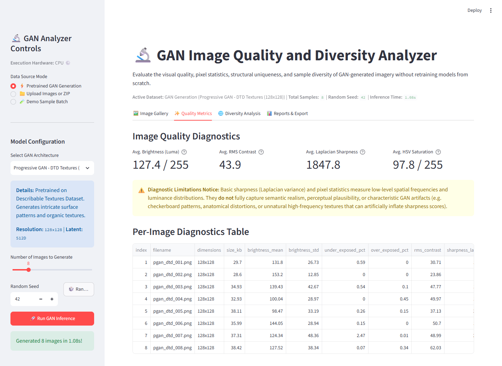
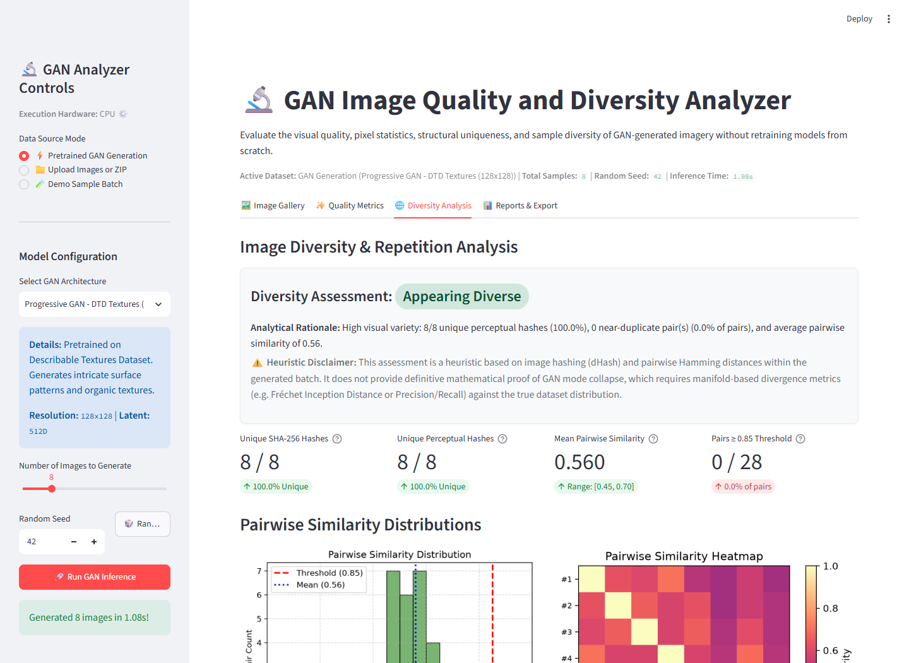
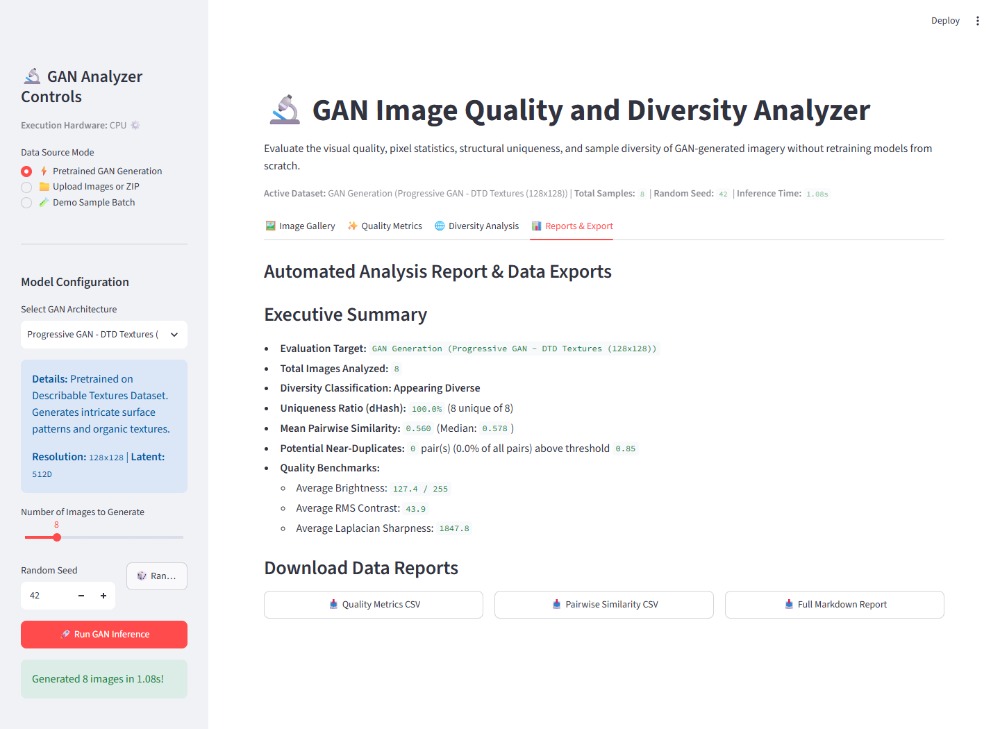

# GAN Image Quality and Diversity Analyzer

A web-based diagnostic application built with **Streamlit**, **PyTorch**, **NumPy**, **Pillow**, **Pandas**, and **Matplotlib** to evaluate the visual quality, structural uniqueness, pairwise similarity, and distribution diversity of images generated by Generative Adversarial Networks (GANs)—without requiring models to be trained from scratch.

---

## 📸 Application Interface Overview

| Image Gallery (Generated Textures) | Quality Diagnostics Table & Metrics |
|:---:|:---:|
|  |  |

| Diversity Assessment & Similarity Heatmap | Automated Executive Reports & Exports |
|:---:|:---:|
|  |  |

---

## 🌟 Key Features

1. **Pretrained GAN Model Inference (Live PyTorch Execution)**
   - **Progressive GAN (PGAN - DTD Textures)**: Generates 128×128 organic surface textures via progressive growing architectures.
   - **Progressive GAN (PGAN - CelebA-HQ)**: Generates 512×512 high-resolution portrait imagery.
   - **Deep Convolutional GAN (DCGAN)**: Real-time neural generator mapping latent Gaussian vectors $z \sim \mathcal{N}(0, I)$ to 64×64 synthetic images via transposed convolutions and batch normalization.
   - Full random seed control (`torch.manual_seed`) for bitwise reproducible generation.
   - Hardware detection with automatic CUDA GPU acceleration and CPU fallback.

2. **Multifactor Ingestion & File Validation**
   - Direct batch upload supporting `.png`, `.jpg`, `.jpeg`, `.webp`, `.bmp`.
   - Compressed archive upload: unpacks `.zip` archives directly in memory.
   - Quick one-click "Demo Sample Batch" loader for instant exploration.

3. **Pixel-Level Image Quality Diagnostics**
   - **Brightness (Mean Luma)**: Evaluated using the ITU-R 601-2 standard luminance formula ($Y = 0.299R + 0.587G + 0.114B$).
   - **RMS Contrast**: Root Mean Square standard deviation of pixel intensities across channels.
   - **Exposure Health**: Percentages of under-exposed ($Y < 25$) and over-exposed ($Y > 230$) pixels.
   - **Spatial Sharpness (Discrete Laplacian Variance)**: Measures high-frequency gradient energy using a 4-neighborhood 2D Laplacian operator.
   - **Gradient Energy**: Central-difference gradient magnitude across horizontal and vertical axes.

4. **Perceptual Similarity & Diversity Diagnostics**
   - **Exact Duplicate Detection**: SHA-256 byte cryptographic hashes.
   - **Difference Hashing (dHash)**: Computes 64-bit gradient direction hashes ($8 \times 8$) invariant to slight gamma shifts or scaling.
   - **Pairwise Similarity Matrix**: Vectorized Hamming distance comparison across all $\binom{N}{2}$ image pairs with interactive heatmaps.
   - **Configurable Similarity Threshold**: Interactive slider (0.50 to 0.98) flagging near-duplicate pairs side-by-side with similarity metrics.
   - **Automatic Heuristic Classification**: Evaluates batch variation as **Appearing Diverse**, **Showing Some Repetition**, or **Highly Repetitive**.

5. **Reporting & Data Export**
   - Downloadable per-image quality metrics in CSV format (`gan_quality_metrics.csv`).
   - Downloadable pairwise similarity matrix and ranked pairs in CSV format (`gan_pairwise_similarity.csv`).
   - Downloadable executive summary report in Markdown format (`gan_diversity_full_report.md`).

---

## 📂 Project Structure

```text
gan_image_analyzer/
├── app.py                     # Streamlit frontend & interactive dashboards
├── model.py                   # PyTorch GAN loading, DCGAN architecture & inference
├── preprocessing.py           # Image validation, ZIP extraction, SHA-256 & dHash
├── analyzer.py                # Quality metrics, pairwise similarity & diversity heuristics
├── test_suite.py              # Unit tests for preprocessing, analyzer, and models
├── capture_screenshots.py     # Playwright automation script for UI screenshots
├── requirements.txt           # Core project dependencies
├── README.md                  # Comprehensive documentation and guide
├── samples/                   # Pre-generated sample GAN images & sample batch ZIP
└── screenshot_*.png           # Demonstration screenshots of the running app
```

---

## ⚙️ Installation & Setup (Windows / VS Code)

### Prerequisites
- Python 3.9 - 3.13
- Git (optional)
- Modern web browser (Edge, Chrome, Firefox)

### Step 1: Clone or Navigate to Project Directory
```powershell
cd C:\Users\nithe_rhnzcl2\.gemini\antigravity\scratch\gan_image_analyzer
```

### Step 2: Create and Activate Virtual Environment
```powershell
python -m venv .venv
.\.venv\Scripts\Activate.ps1
```

### Step 3: Install Dependencies
```powershell
# For CPU execution:
pip install torch torchvision --index-url https://download.pytorch.org/whl/cpu
pip install streamlit numpy pillow pandas matplotlib

# Or install from requirements.txt:
pip install -r requirements.txt
```

---

## 🚀 Running the Application

Launch the Streamlit web application:
```powershell
streamlit run app.py
```

Once running, the terminal will display:
```text
Local URL: http://localhost:8501
Network URL: http://...
```
Open [http://localhost:8501](http://localhost:8501) in your browser.

---

## 🧪 Running Unit Tests

Run the automated test suite verifying perceptual hashing, Laplacian sharpness, DCGAN inference, and duplicate detection:
```powershell
python test_suite.py
```
Expected output:
```text
.......
----------------------------------------------------------------------
Ran 7 tests in 0.12s

OK
```

---

## 🔬 Methodology & Formulations

### 1. Difference Hashing (dHash)
The difference hash algorithm extracts structural edge directionality:
1. Converts the image to 8-bit grayscale.
2. Bilinearly resizes the image to $(W+1) \times H = 9 \times 8 = 72$ pixels.
3. Computes adjacent horizontal gradient booleans: $B_{y, x} = (P_{y, x+1} > P_{y, x})$.
4. Flattens into a 64-bit binary vector and packs into a 16-character hexadecimal string.
5. The pairwise similarity score between image $A$ and image $B$ is:
   $$\text{Similarity}(A, B) = 1.0 - \frac{\text{HammingDistance}(H_A, H_B)}{64}$$

### 2. Discrete Laplacian Sharpness
Sharpness is computed by applying the discrete Laplacian operator directly on grayscale pixel intensities:
$$L[y, x] = I[y-1, x] + I[y+1, x] + I[y, x-1] + I[y, x+1] - 4 \cdot I[y, x]$$
The sample sharpness metric is the sample variance:
$$\text{Sharpness} = \mathrm{Var}(L)$$

> [!WARNING]
> **Diagnostic Limitations Notice**: Basic sharpness (Laplacian variance) and pixel statistics measure low-level spatial frequencies and luminance distributions. They **do not** fully capture semantic realism, perceptual plausibility, or characteristic GAN synthesis artifacts (such as transposed-convolution checkerboard patterns, structural distortions, or high-frequency speckle noise that can artificially inflate sharpness scores).

### 3. Diversity Classification Heuristic
The image batch is evaluated against intra-sample diversity thresholds:
- **Highly Repetitive**: Uniqueness ratio $< 70\%$, OR $\ge 25\%$ of pairs exceed similarity threshold, OR mean pairwise similarity $\ge 0.80$.
- **Showing Some Repetition**: Uniqueness ratio $70\% - 92\%$, OR $5\% - 25\%$ of pairs exceed threshold, OR mean similarity $0.68 - 0.80$.
- **Appearing Diverse**: Uniqueness ratio $\ge 92\%$, $< 5\%$ near-duplicate pairs, and mean similarity $< 0.68$.

> [!NOTE]
> **Heuristic Disclaimer**: This classification evaluates structural uniqueness and repetition within this specific sample batch. It serves as a rapid diagnostic heuristic and should not be treated as mathematical proof of GAN mode collapse (which requires benchmark evaluation against the true training data manifold using metrics such as Fréchet Inception Distance or Precision/Recall for Generative Models).

---

## 🛠️ Error Handling & Fallbacks
- **PyTorch Hub Compatibility**: Automatically patches legacy PyTorch 1.x optimizer parameters (`betas=[0, 0.99]`) so modern PyTorch 2.x runtimes load hub models seamlessly.
- **Offline / Network Outage Fallback**: If remote pretrained checkpoints cannot be reached or fail to download, the application clearly presents the error and provides the self-contained neural DCGAN generator and user image/ZIP upload modes.
- **Image Corruption Safeguards**: Ingestion functions validate byte integrity using `PIL.Image.open()` and `verify()` to prevent application crashes from truncated or malformed files.
